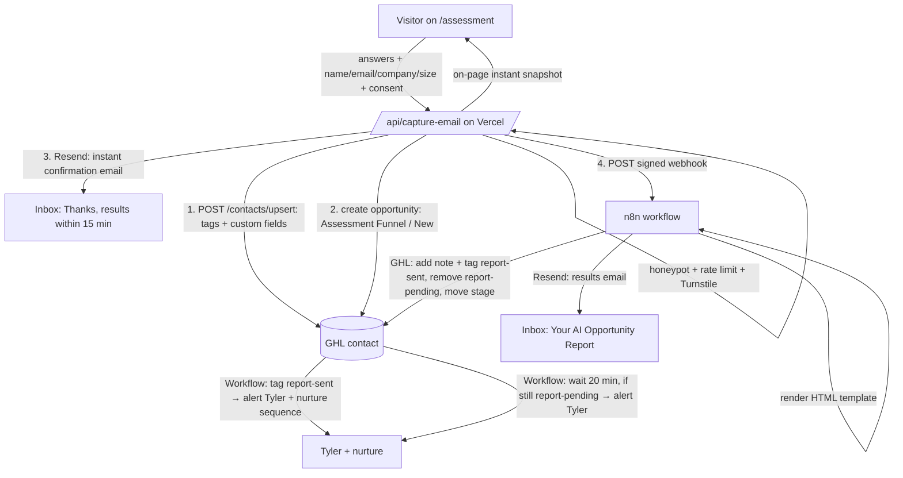

# Free AI Assessment → GHL Lead Funnel: Audit + Plan

Prepared Nov 3, 2026. Planning only: no code, commits, or GoHighLevel (GHL) settings were changed.
Tags: **[verified]** = I checked it directly. **[unverified]** = from secondary sources or inference, so confirm before relying on it.

---

## TL;DR

- **Leads are being lost today. [verified]** `app/api/capture-email/route.ts` only runs `console.log` (lines 35–44). The Resend code is commented out, and nothing goes to GHL.
- **The results page makes a promise nothing keeps.** It tells visitors "We've sent a detailed report… usually arrives within 10 minutes" (`AssessmentForm.tsx` 408–424), but no email is ever sent.
- **Competitors deliver within a minute.** Certified AI Partners (CAP) shows an AI report on the page in about 15 s and emails it with a PDF in under a minute. Claude Academy emails a numbers report about 2 minutes after the visitor asks for it.
- **Recommended setup (a mix):** the site API route writes the lead to GHL straight away, so it's never lost, and sends the instant confirmation through Resend. n8n then generates the Claude report and sends it through Resend. GHL owns the pipeline, alerts and nurture.
- **Cost: under $0.10 per lead. [unverified estimate]** Claude Sonnet 5.5 costs about $0.03–0.08 per report. Resend is free up to 3,000 emails a month.
- **Effort:** about 15–25 build hours across 4 phases, plus 1–2 hours of your setup (keys, DNS, sign-ins).
- **DNS gaps:** the root domain has **no SPF record** and there is **no DMARC record**. The Resend records are present.

---

## Part 1: Repo audit

### What exists

| Piece | File | State |
|---|---|---|
| Quiz page | `app/assessment/page.tsx` | Live but not linked from nav (links removed in commit `8b6fac9`). Metadata says "7 quick questions", but there are 9. |
| Quiz UI | `components/assessment/AssessmentForm.tsx` | Flow: intro → 9 questions → 2.2 s "computing" teaser → gate (name, email, company) → results. Good UX shell. |
| Questions | `components/assessment/questions.ts` | 9 multiple-choice questions (below). No free text, no hours/$ inputs. |
| Scoring | `components/assessment/scoring.ts` | 5 pillars → tier (AI-Curious / AI-Ready / AI-Leading). **`computePeerPercentile` invents a "Top X% of Sacramento-area…" ranking from a formula**, not from data. |
| Share badge | `components/assessment/ShareBadge.tsx` | LinkedIn badge + post text. It spreads the made-up percentile. |
| Lead capture | `app/api/capture-email/route.ts` | **Only logs to the console. Leads are lost. [verified]** Also writes personal info (PII) to the logs. No honeypot or rate limit. |
| Pre-call form | `app/api/questionnaire/route.ts` + `components/PreCallForm.tsx` (`/questionnaire`) | Forwards to `QUESTIONNAIRE_WEBHOOK_URL` (n8n) if it's set. If not, it logs and still returns success. Good forwarding pattern to reuse. |
| Contact form | `app/api/contact/route.ts` | **Best code to reuse:** honeypots, per-IP rate limit, length clamps, `escapeHtml`, and it checks Resend's `error` result. |
| Booking | `lib/booking.ts` | Stopgap `mailto:` link. `BOOKING_EMBED_URL = null`, so the embedded scheduler on the results page is hidden. |
| Resend | `resend@^3` in package.json; `.env.local` has `RESEND_API_KEY` and `RESEND_FROM_EMAIL=Sacramento AI Agency <contact@sacramentoaiagency.com>` | DNS records for Resend exist (see Part 3). Vercel production env vars not checked **[unverified]**. |
| Stripe | `app/api/checkout/route.ts` | `success_url` = `/assessment?payment=success`, which sends paid $997 buyers to the *free* quiz. Nothing on that page handles the parameter. |
| GHL | `components/GhlTracking.tsx`, `ChatWidget.tsx`, `docs/connect-site-to-go-high-level.md` | Tracking script and chat widget (`6ae6c63d03d93fc52138845d`) are wired up. The earlier doc proposed a GHL *inbound webhook*. This plan prefers the direct API (see Part 3). |

**Repo state warning:** the working tree already has 10 modified files and untracked files (homepage/hero/chat/GhlTracking work) that aren't committed. Commit or stash those deliberately before the funnel build, so nothing ships to `main` by accident.

### Current questions (all single-choice A–D)

1. Which best describes your business? Options: construction/trades/real estate, professional services, healthcare, or other *(identity)*
2. How big is your team? Options: just me, 2–10, 11–50, or 50+ *(identity = company size ✅)*
3. Where does customer info live? *(data)*
4. How do you get a key number? *(data)*
5. Are repeated workflows documented? *(process)*
6. Hours/week on repetitive manual tasks: 30+, 15–30, 5–15, or under 5 *(process)*
7. How did past tool rollouts go? *(team)*
8. Where is AI on your priority list this quarter? *(leadership)*
9. Do you have a specific workflow in mind? *(vertical)*

The gate collects **name, email and company**, all required. Company size comes from Q2. **Missing:** a free-text bottleneck, hours spent on *that* task, hourly value or revenue band, website, role or decision-maker, and consent.

### What's broken

1. Leads are lost (console.log only).
2. The promised email never sends ("within 10 minutes").
3. The "Top X%" peer ranking is made up, and the share badge spreads it. This is a credibility and FTC-claims risk.
4. The client ignores API failures. `fetch` is never checked with `res.ok`, and the `catch` swallows errors, so every visitor sees success.
5. No bot protection on `/api/capture-email`.
6. The form says "No spam. Unsubscribe any time", but there's no unsubscribe path and no consent checkbox.
7. Copy mismatches: "7 questions" vs 9; a "20-min" call on results vs a 15-min call elsewhere.
8. The booking CTA is a mailto stopgap.
9. Naming clash: "Free AI Opportunity Assessment" vs the paid "$997 AI Leverage Assessment".
10. No dollar ROI and no ranked opportunities. The output is generic pillar text, the same for everyone in a band.

### Reusable as-is

- Quiz shell, progress bar, gate → results flow, and pillar scoring (as a *readiness snapshot*)
- The contact route's anti-abuse and Resend error-handling pattern
- The questionnaire route's webhook-forwarding pattern
- Resend package plus the authenticated domain
- `GhlTracking`, so contact page views attach to GHL contacts

---

## Part 2: Competitive audit

### (a) Certified AI Partners: taken end to end **[verified]**

| | Detail |
|---|---|
| Entry | Homepage hero: "Find your #1 AI opportunity in less than a minute". CTA: "Get my #1 AI opportunity". |
| Questions (10 steps) | 1. Company website (they read the site in the background and show a summary of it) · 2. **"Where does your business lose the most time?"** (free text) · 3. Team hours/week on it (1–2 / 2–5 / 5–10 / 10–20 / 20–40 / 40+ / not sure) · 4. **"Where does [X] slow down?" — AI-generated multi-select options tailored to the step 2 answer** · 5. Tools it touches (multi-select) · 6. What happens when it slips (leads go cold / I do it at night / …) · 7. Annual revenue band · 8. Owner/decision-maker? · 9. First name · 10. Email gate |
| Fields captured | Website, bottleneck text, hours, friction points, tools, consequence, revenue, decision-maker status, first name, work email |
| Email gate | **After** generation. The report headline shows, with the body blurred behind "Your report is ready. Where should we send it?" Email only. Submitting counts as agreeing to their Terms/Privacy (no checkbox). |
| Time | About 2 min to answer, plus about 15 s of generation with a countdown ("Reading your website") |
| Delivery | Instant on-page report at a unique URL (`assessments.certifiedaipartners.com/free/result/<uuid>`), **plus an email in under 1 min** from `reports@noreply.certifiedaipartners.com` with the PDF attached |
| Report | Personalized headline ("Tyler, Rewrite and follow-up take too long"), what they read on the website, the workflow and reported hours, a quote of your words, "The opportunity", **value estimate (5.3 h/wk = 70% of 7.5 h → $9,555/yr; year one about $5,733 at a 60% ramp)** with **editable assumptions** and a disclaimer ("not a payroll reduction claim"), a Today vs With AI 5-step workflow toggle, PDF download, and a **ready-made DIY prompt with "Open in ChatGPT / Open in Claude" buttons** |
| Design | Editorial serif headings and a gold accent. Calm, premium, and very readable. |
| CTA / upsell | "That was one workflow. Most companies that do a full assessment find 6 to 10 more…" → **"Book your full assessment — 30 minutes. Bring this report."** The email adds "Reply… a real person reads it." Later follow-up hasn't been observed yet. |

### (b) Corey Ganim: no self-serve online assessment found **[verified for site; method is secondhand]**

- coreyganim.com offers a newsletter (Corey's Notes, 11,706+), AI Operator Academy ($149/mo on Skool) and an "AI Concierge" contact form. No quiz or calculator.
- `audittemplate.ai` redirects to a Kit form, "Steal the Template We Use to Deliver $999 AI Audits", which requires **email + phone**. **I didn't submit it** because you didn't give me a phone number to use.
- His "free mini assessment" is a **human process: a 15-min interview → research → a second 15-min call prescribing one tool** **[unverified, from a third-party write-up]**. His ladder: free mini assessment → $999 AI Tools Assessment (6-part report: exec summary, effort/impact matrix, quick wins, solutions, 4-day plan, financial impact) → $1–2K/mo Concierge.
- Follow-up seen in the zephyrways inbox: **near-daily newsletter emails with urgency** ("last day (the price goes up tonight)", "we're raising the price…").

### (c) Claude Academy (Denis Laflamme) "time back" calculator: taken **[verified]**

| | Detail |
|---|---|
| Questions | Trade (12 options) → two tabs. **Calls you miss:** calls/day, days open, average job $, who answers. **Busywork:** tick 8 tasks (quotes, invoicing, booking, email, lead follow-up, social, reviews, data entry) with hrs/wk each, who does it, your hourly value, staff wage. All pre-filled with trade defaults. |
| Gate | **None to see the numbers** ("No email needed to see your numbers"). Optional "Email me this report" asks for first name + email, has a **separate unchecked marketing-consent box**, and a hidden honeypot field. |
| Time | About 1 min |
| Delivery | Live on-page totals (8.4 h/wk busywork, $31,500/yr). The email arrived about 2 min after the request, from `hello@claudeacademy.ca`. |
| Report email | Big number (12.1 h/wk ≈ 607 h/yr), line-item math, "How the math works" assumptions, CTA "Book the free 15 minute call. Bring this email", a P.S. linking a free book, and a **physical address + unsubscribe (CAN-SPAM compliant)** |
| Ladder | Free book/community → $249 Skills Pack → **$1,000 Hours Audit with a "if it doesn't find hours, you don't pay" guarantee** → AI Concierge. This is very close to your $997 + 10× guarantee. |

### Gap analysis: what they do that yours doesn't

| Gap | CAP | Claude Acad. | Yours |
|---|---|---|---|
| Free-text "biggest bottleneck" | ✅ | — | ❌ |
| Dollar value per opportunity, assumptions shown and editable | ✅ | ✅ | ❌ |
| Personalized by website/answers (LLM) | ✅ | — | ❌ |
| Instant on-page result | ✅ | ✅ | ✅ (generic) |
| Email actually delivered | ✅ <1 min | ✅ ~2 min | ❌ never |
| PDF / shareable report link | ✅ | — | Badge only |
| DIY prompt ("try it tonight") | ✅ | Free book | ❌ |
| CTA tied to paid offer ("bring this report") | ✅ | ✅ | Generic call/mailto |
| Consent + unsubscribe + address | Terms only | ✅ | ❌ |
| Honest benchmarks | ✅ | ✅ | ❌ fake percentile |

### Highest-value improvements, ranked

1. **Stop the leak:** GHL upsert, a confirmation email, and an honest promise. Without this, nothing else matters.
2. **Add 3 inputs:** biggest time drain (free text), hours/week on it, and hourly value (or revenue band). Optional: website. These turn the report from generic into specific.
3. **AI report with a ranked opportunity list:** the top 3, each with h/wk, **$/yr = hours × rate × 50 wks × capture %** (show the formula), effort, a suggested tool, and today vs with-AI steps.
4. **Instant on-page preview:** show the tier, the #1 opportunity title and the $ range immediately. The full report arrives by email in about 1–2 min. Keep "within 15 minutes" as the stated buffer.
5. **CTA tied to the $997 AI Leverage Assessment:** "This found 3. The Leverage Assessment maps all of them, and if it doesn't find 10× the fee, you get your money back." Add a GHL calendar booking link (this also replaces the mailto stopgap).
6. **DIY prompt block** with Open in Claude/ChatGPT. It builds trust and costs nothing.
7. **Remove the made-up percentile.** Replace it with "Tier + pillar scores", or real stats once you have 50+ submissions.
8. **Nurture in GHL:** day 0 report, day 2 personal check-in from Tyler, day 5 case study, day 10 offer. Low pressure, no fake urgency.

---

## Part 3: Architecture

### Options compared

| | A. All inside GHL (form/survey + workflow + GHL AI) | B. Site API → GHL API + LLM API (all in Next.js) | C. n8n does everything | **D. Mix (recommended)** |
|---|---|---|---|---|
| Reliability | Good for the CRM. AI step is a black box. | Good, but long LLM calls inside serverless functions; retries are hand-built | n8n downtime = lost lead unless the site also saves it | **Lead saved to GHL synchronously; AI in n8n with retries + fallback alert** |
| Cost/lead | Premium triggers/actions about $0.01 each after 100 free **[unverified]** + AI action credits | ~$0.05 | ~$0.05 + n8n hosting | **~$0.05–0.10** |
| Speed | Minutes | Seconds | Seconds | **Confirmation <5 s, report ~1–2 min** |
| Your maintenance | Low; edit in GHL | High; every prompt tweak = code deploy | Medium; visual, you can edit | **Low–medium; edit prompt/email in n8n, CRM in GHL** |
| Report quality | Limited prompt/format control **[unverified]** | Full control | Full control | **Full control (Claude + HTML template)** |
| Keeps your quiz design | ❌ (GHL form embed) | ✅ | ✅ | ✅ |

### Recommended flow

Why the site writes to GHL directly rather than through a GHL inbound webhook: the upsert API is free. It returns the contact ID, which n8n needs to update the same contact, and it doesn't depend on a premium trigger. The inbound-webhook route from the old doc still works if you'd rather not manage a token.

### Who sends what

| Email | Sender | From | Why |
|---|---|---|---|
| Instant confirmation ("Thanks… results within 15 minutes") | **Site route → Resend** | `reports@sacramentoaiagency.com` (Resend domain) | Fastest and simplest. Works today because the Resend DNS is in place. |
| Personalized results (target 1–2 min, promise ≤15) | **n8n → Resend** | same | Full HTML control; n8n can retry on failure |
| Alert to Tyler | GHL workflow (or Resend) | — | Lives with the pipeline |
| Nurture (days 2/5/10) | **GHL** | Needs a GHL/LC Email sending domain set up | Marketing email belongs in GHL, which handles unsubscribe/DND |

Later you can move both emails into GHL (n8n sends through the GHL Conversations API) so everything shows in the GHL inbox. Do that once a GHL sending domain is authenticated.

### LLM choice and cost

- **Use the Anthropic API with Claude Sonnet 5.5.** It writes well for business owners, follows a JSON output format reliably, and the brand fits, since you sell Claude-based services. **Official price: $2 per million input tokens / $10 per million output. [verified on platform.claude.com pricing page]**
- **Per report:** about 6–10K input tokens (instructions + answers + optional homepage text) and 2–3K output. That works out to **about $0.03–0.05**, or about $0.08 with a large website excerpt. Opus 5.5 ($4/$20) roughly doubles that, if you ever want more polish. Haiku 5.5 ($0.10 input) is fine for classification but too thin for the report itself.
- **Your subscriptions (Claude Pro/Max, ChatGPT Plus, Gemini, Grok) do not include API access.** You need a separate API key at platform.claude.com with prepaid or usage billing. **Set a monthly spend limit** (e.g. $20).
- Gemini Flash or GPT-mini would be cheaper, but at about $0.05 per lead, cost isn't the deciding factor. Quality is.

### Email deliverability: DNS for sacramentoaiagency.com **[verified via dns.google, Nov 3]**

| Record | Found | Status |
|---|---|---|
| Nameservers | Namecheap (`dns1/2.registrar-servers.com`) | — |
| MX (root) | `smtp.google.com` (Google Workspace) | ✅ |
| SPF (root) | **None.** Only a `google-site-verification` TXT. | ❌ Add `v=spf1 include:_spf.google.com ~all` so tyler@ mail passes SPF |
| DKIM Google | `google._domainkey` present | ✅ |
| DKIM Resend | `resend._domainkey` present | ✅ |
| SPF Resend | `send.` → `v=spf1 include:amazonses.com ~all`, plus MX `feedback-smtp.us-east-1.amazonses.com` | ✅ (Resend dashboard status unverified) |
| DMARC | **None** (`_dmarc` NXDOMAIN) | ❌ Add `v=DMARC1; p=none; rua=mailto:tyler@sacramentoaiagency.com`, and tighten to `quarantine` after 2–4 clean weeks |
| GHL / LC Email sending domain | Not found at the subdomains checked (`mg.`, `replies.`) | ⚠️ **[unverified]**. Set one up in GHL before sending nurture from GHL. |

**Recommendation:** send from Resend on your domain now. Add the root SPF and DMARC records this week.

### Spam/bot protection, consent, data

- **Bots:** copy the contact route's honeypots and IP rate limit. Add **Cloudflare Turnstile** (free, invisible) and verify it on the server. Clamp field lengths. Reject throwaway email domains (optional).
- **Webhook security:** the site signs the n8n call with a shared secret header (`X-Webhook-Secret`), and n8n rejects anything without it.
- **CAN-SPAM:** the results email is requested content (transactional), but it carries a CTA, so include your **physical mailing address**, a working **unsubscribe link**, and accurate From/Subject lines. Add an **unchecked** checkbox: "Send me occasional tips from Sacramento AI Agency". Only contacts who tick it get the `marketing-consent` tag and the nurture sequence. Others get only the report plus a single follow-up from you. Link the privacy policy. **(Not legal advice.)**
- **No PII in logs:** remove the `console.log` of full leads.
- **GHL custom fields (contact):** `assessment_industry`, `assessment_team_size`, `assessment_tier`, `assessment_score`, `assessment_pillars` (text), `assessment_bottleneck` (large text), `assessment_hours_per_week` (number), `assessment_hourly_value` (number), `assessment_website`, `assessment_top_opportunity` (text), `assessment_est_annual_value` (number), `assessment_answers_json` (large text), `assessment_submitted_at` (date), `assessment_report_status` (pending/sent/failed).
- **Tags:** `assessment-submitted`, `assessment-ai-curious|ready|leading`, `report-pending` → `report-sent`, `marketing-consent`.
- **Pipeline:** "Free Assessment": New → Report Sent → Call Booked → Paid Assessment ($997) → Retainer.

---

## Part 4: Build plan

| Phase | What | Who | Hours |
|---|---|---|---|
| **0. Setup** | Create the keys and records in the checklist below; add SPF + DMARC | Tyler (at the Mac) | 1–2 |
| **1. Stop the leak** | `/api/capture-email` → GHL upsert, tags, custom fields, opportunity; Resend confirmation; honeypot/rate limit/Turnstile; check `res.ok` on the client and show a real error; remove PII logs; remove the fake percentile; fix the "7 questions" and promise copy; consent checkbox. Test on a Vercel preview with the test GHL env, then ship. | Claude builds, Tyler approves the push | 4–6 |
| **2. AI report** | n8n workflow: secured webhook → (optional) homepage fetch → Claude → JSON validation → HTML email → Resend → GHL note/tags/stage; failure branch alerts Tyler. GHL workflow for the 20-min "still pending" alert. | Claude drafts (n8n JSON import or in-browser), Tyler pastes keys | 5–8 |
| **3. Better questions + ROI + CTA** | Add bottleneck text, hours, hourly value, website, role; on-page instant snapshot with $ range; CTA to $997 + GHL calendar link in `lib/booking.ts`; DIY prompt block; rename the free quiz ("AI Opportunity Snapshot"). | Claude | 4–6 |
| **4. Nurture + launch** | GHL nurture (days 2/5/10, consent-gated); internal alert; nav/home link back to `/assessment`; Vercel Analytics events (start, complete, submit); 5 end-to-end tests, one per tier, then delete the test contacts. | Claude + Tyler | 2–4 |
| **Total** | | | **~16–26 h** |

### Access checklist

| Item | Where | Who creates it | Notes |
|---|---|---|---|
| GHL **Private Integration token** | GHL sub-account → Settings → Private Integrations | **Tyler** | Scopes: contacts read/write, opportunities read/write, custom fields read (write if I create the fields), tags/notes **[confirm exact scope names in the UI]**. Treat it like a password. |
| GHL **Location ID** | Settings → Business Profile | Tyler (or me, read-only, if you're signed in in Chrome) | Not secret |
| GHL **custom fields** (list above) | Settings → Custom Fields | Me via Chrome/API **with your OK**, or you | Needs the field IDs/keys afterward |
| GHL **pipeline + stage IDs** | Opportunities → Pipelines | Me via Chrome with your OK, or you | |
| GHL **workflows** (alert, pending-check, nurture) | Automation → Workflows | Me via Chrome with your OK | Premium triggers may need enabling in agency settings **[unverified]** |
| GHL **calendar** booking link | Calendars | Tyler picks availability; I wire it in | Replaces the mailto stopgap |
| GHL **email sending domain** (for nurture) | Settings → Email Services | Tyler (adds DNS records) | Only needed for GHL-sent email |
| **Anthropic API key** + billing + spend limit | platform.claude.com | **Tyler** | Separate from the Claude Pro/Max subscription |
| **n8n** webhook URL + shared secret | Your n8n instance | Me (build) / Tyler (paste credentials) | **Need to know: n8n Cloud or self-hosted, and its URL?** |
| **Resend API key** for n8n (sending-only) | resend.com → API Keys | **Tyler** | Also confirm the domain shows "Verified" in Resend |
| **Cloudflare Turnstile** site key + secret | dash.cloudflare.com | **Tyler** | Free |
| **Vercel env vars (Production)** | Vercel → Settings → Environment Variables | **Tyler pastes the secrets** | `GHL_PRIVATE_TOKEN`, `GHL_LOCATION_ID`, `GHL_PIPELINE_ID`, `GHL_STAGE_NEW_ID`, `N8N_ASSESSMENT_WEBHOOK_URL`, `N8N_WEBHOOK_SECRET`, `RESEND_API_KEY` (check it exists), `RESEND_FROM_EMAIL`, `TYLER_NOTIFICATION_EMAIL`, `TURNSTILE_SECRET_KEY`, `NEXT_PUBLIC_TURNSTILE_SITE_KEY` |
| **DNS: root SPF + DMARC** | Namecheap → Advanced DNS | **Tyler** (I give exact values) | |
| **GitHub push** | From Claude Code on the Mac | Works | Clean up the existing uncommitted changes first |
| **Chrome sign-ins** | GHL, n8n, Vercel, Resend, Namecheap, platform.claude.com | **Tyler** | I can't enter passwords or paste API keys into web forms |

### Needs you at the Mac

- Signing in and approving 2FA (GHL, Vercel, n8n, Namecheap, Anthropic, Resend, Cloudflare)
- Pasting every secret (tokens and API keys) into Vercel and n8n
- Adding Anthropic billing and the spend cap
- Approving Chrome site permissions when I work in GHL or n8n
- DNS edits
- Approving the push to `main` (that's a live deploy) and running the test submissions

---

## Sources

- Repo files cited inline (`app/api/capture-email/route.ts`, `components/assessment/*`, `app/api/contact/route.ts`, `app/api/questionnaire/route.ts`, `lib/booking.ts`, `.env.example`, `docs/connect-site-to-go-high-level.md`)
- [Certified AI Partners](https://certifiedaipartners.com/) (assessment taken Nov 3, 2026; report emailed to zephyrways@gmail.com)
- [Claude Academy time-back calculator](https://claudeacademy.ca/calculator) (taken Nov 3, 2026; report emailed)
- [coreyganim.com](https://www.coreyganim.com/), [coreyganim.com/services](https://www.coreyganim.com/services), [AI Operator Academy](https://www.skool.com/aioperatoracademy/about), [audittemplate.ai](https://audittemplate.ai/)
- [JQ AI Systems: Corey Ganim's services ladder](https://www.ai.joaoqueiros.com/blog/ai-services-offer-ladder-free-assessment-999-ai-concierge) (secondhand)
- [Anthropic pricing](https://platform.claude.com/docs/en/about-claude/pricing)
- [HighLevel API: Upsert Contact](https://marketplace.gohighlevel.com/docs/ghl/contacts/upsert-contact)
- [GHL premium triggers & actions](https://help.gohighlevel.com/support/solutions/articles/48001231559-how-to-enable-and-rebill-lc-premium-triggers-actions-for-workflows) **[unverified details]**
- [Resend pricing summary](https://costbench.com/software/email-api/resend/free-plan/) **[secondary source]**
- DNS: `dns.google/resolve` queries for TXT/MX/NS/DKIM/DMARC on sacramentoaiagency.com
